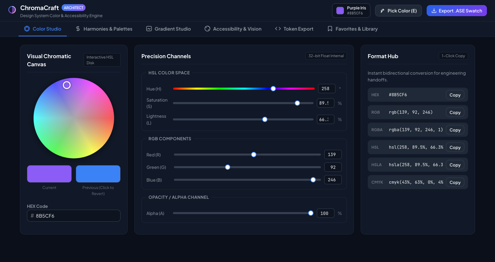
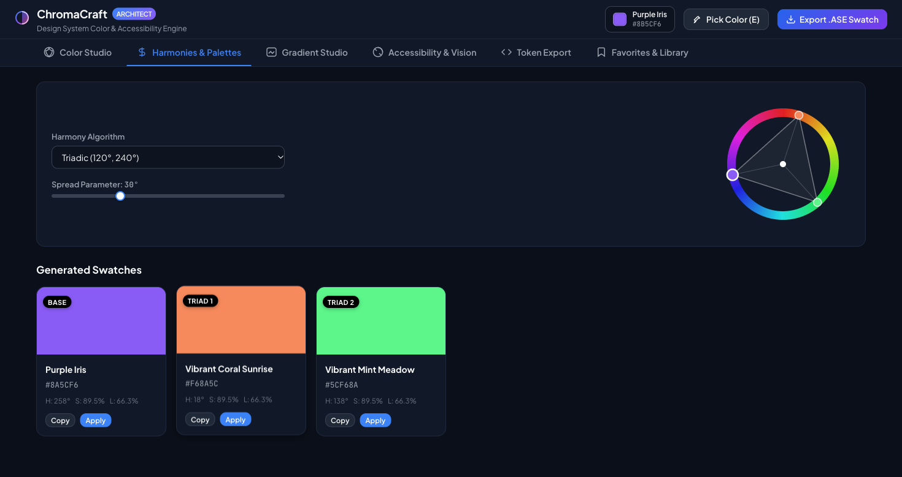
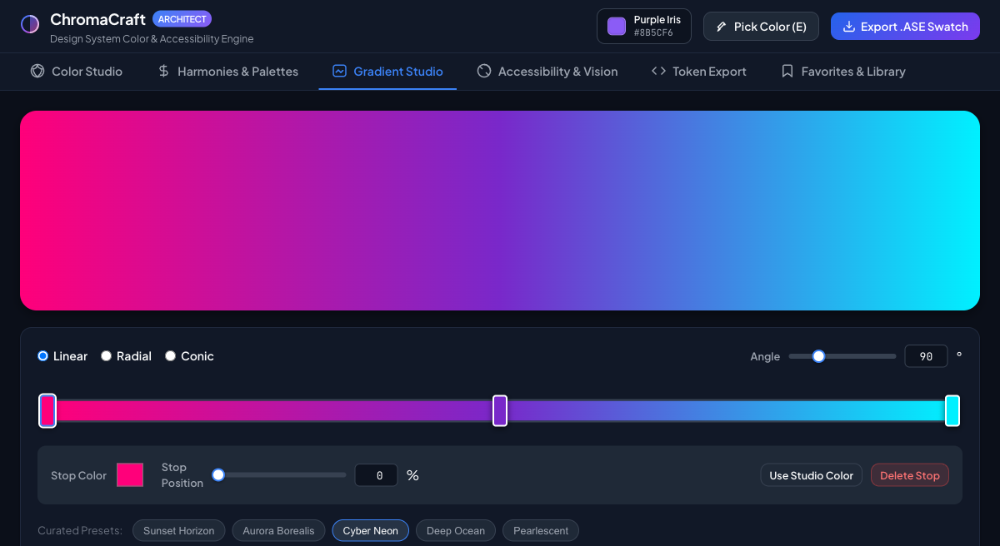
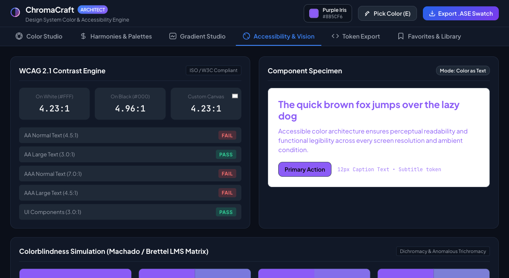
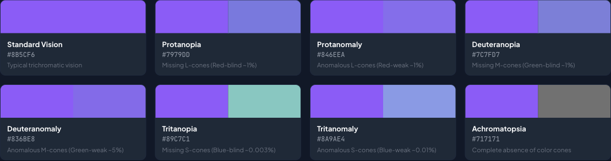
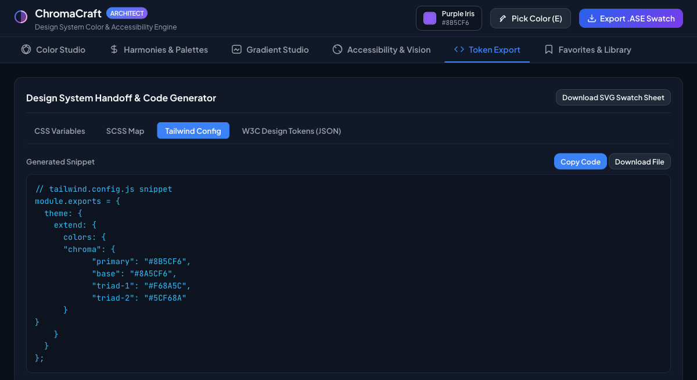

# ChromaCraft Studio 🎨
> **Professional Color Architecture, Harmony Algorithms & Inclusive Design System Engine**  
> *Built with semantic HTML5, modern CSS3 custom properties, and zero-dependency vanilla JavaScript (ES6+).*

---

## 📖 Table of Contents
1. [Overview & Architectural Philosophy](#-overview--architectural-philosophy)
2. [Key Capabilities & Modules](#-key-capabilities--modules)
   - [1. Color Studio (Precision Channels & Format Hub)](#1-color-studio)
   - [2. Harmonies & Palettes (Geometric Chord Visualization)](#2-harmonies--palettes)
   - [3. Gradient Studio (Multi-Stop Timeline & CSS Generator)](#3-gradient-studio)
   - [4. Accessibility & Vision (WCAG 2.1 & Colorblindness)](#4-accessibility--vision)
   - [5. Token Export & Adobe ASE Generator](#5-token-export--adobe-ase)
   - [6. Favorites & Collections Library](#6-favorites--library)
3. [Quick Start & Running the Application](#-quick-start--running-the-application)
4. [Keyboard Shortcuts](#-keyboard-shortcuts)
5. [Architectural Experiments & Technical Lessons Learned](#-architectural-experiments--technical-lessons-learned)
   - [Experiment 1: High-DPI (Retina) Canvas Scaling Pitfall & Physical Pixel Mapping](#experiment-1-high-dpi-retina-canvas-scaling-pitfall)
   - [Experiment 2: LMS Colorblindness Confusion Matrices vs Naive CSS Filters](#experiment-2-lms-colorblindness-confusion-matrices)
   - [Experiment 3: In-Memory Binary Serializer for Adobe Swatch Exchange (.ASE)](#experiment-3-in-memory-binary-serializer-for-adobe-ase)
   - [Experiment 4: Event Source Tagging to Prevent Pub/Sub Feedback Loops](#experiment-4-event-source-tagging)
   - [Experiment 5: WCAG 2.1 Relative Luminance & Contrast Mathematics](#experiment-5-wcag-21-relative-luminance)
6. [Project File Structure](#-project-file-structure)
7. [Browser Compatibility](#-browser-compatibility)

---

## 🌟 Overview & Architectural Philosophy

Designers and engineers frequently suffer from fragmented color workflows: jumping between disconnected tools to pick a color, converting RGB to HEX manually, guessing WCAG compliance under launch deadlines, and having no direct bridge between design tokens and Adobe/Figma swatches.

**ChromaCraft Studio** eliminates this friction. It unifies color selection, harmony generation, gradient creation, accessibility audits, and design system token export into a single, high-performance web application.

### Key Architectural Principles
- **Zero External Dependencies**: Pure vanilla HTML5, CSS3, and ES6+ JavaScript. No frameworks, build steps, or external math libraries required.
- **Single Source of Truth (SSOT)**: A centralized pub/sub reactive store (`ColorCore.store`) drives all UI components. Any edit instantly synchronizes across every module without lag.
- **Production Design System Handoff**: Exports directly into CSS Custom Properties, SCSS Maps, Tailwind Configs, W3C Design Tokens JSON, and binary **Adobe Swatch Exchange (`.ASE`)** files.

---

## 🚀 Key Capabilities & Modules

### 1. Color Studio


- **High-DPI HSL Canvas Wheel**: Interactive 360° color disc with radial saturation calculation and precision antialiasing.
- **Precision Channel Sliders**: Independent HSL, RGB, and Alpha/Opacity slider controls with real-time numeric inputs.
- **Hardware EyeDropper API**: Native desktop screen loupe (`window.EyeDropper`) to sample any pixel across your monitor.
- **Split-Swatch Card**: Compares your current edit against the previous color; click the previous swatch at any time to revert.
- **Bidirectional Format Hub**: Real-time bidirectional conversion between HEX, RGB, RGBA, HSL, HSLA, and CMYK with 1-click clipboard copy.

### 2. Harmonies & Palettes


- **6 Algorithmic Harmony Rules**:
  - **Complementary (180°)**: Classical high-contrast pairing.
  - **Analogous (± Spread)**: Natural adjacent transitions.
  - **Triadic (120°, 240°)**: Vibrant equilateral balance.
  - **Tetradic / Double Complementary (90° / 180°)**: Rich rectangular harmony.
  - **Split-Complementary (150°, 210°)**: Sophisticated contrast with less visual tension.
  - **Monochromatic**: 5-step luminance and saturation progression.
- **Interactive Geometric Chord Wheel**: Renders vector chord polygons linking harmony nodes on a canvas ring.
- **Dynamic Swatch Cards**: Displays contrast ratios, HSL metadata, 1-click copy, and "Apply as Primary" buttons.

### 3. Gradient Studio


- **Gradient Types**: Linear (with 0–360° angle slider/numeric dial), Radial, and Conic.
- **Multi-Stop Interactive Timeline**:
  - Click anywhere along the track to add a color stop.
  - Drag stop handles horizontally to reposition.
  - Change stop color via native color input or set to active studio color.
  - Delete stops (maintaining a minimum of 2 stops).
- **Curated Presets**: Quick-load *Sunset Horizon*, *Aurora Borealis*, *Cyber Neon*, *Deep Ocean*, and *Pearlescent*.
- **Copy-Ready CSS Output**: Formatted CSS `background: linear-gradient(...)` rules generated on the fly.

### 4. Accessibility & Vision


- **WCAG 2.1 Contrast Engine**: Computes exact contrast ratios against Pure White (`#FFFFFF`), Pure Black (`#000000`), and any custom canvas color.
- **Compliance Badges**: Instant PASS / FAIL evaluations for:
  - AA Normal Text (≥ 4.5:1)
  - AA Large Text (≥ 3.0:1)
  - AAA Normal Text (≥ 7.0:1)
  - AAA Large Text (≥ 4.5:1)
  - UI Components & Graphical Objects (≥ 3.0:1)
- **Live Typography Specimen**: Interactive H1, body copy, and primary action button preview. Toggle between **Color as Text** and **Color as Background**.
- **Physiological Colorblindness Simulator**: Simulates 7 distinct visual conditions via Machado & Brettel LMS confusion matrices:
  - Standard Vision
  - Protanopia & Protanomaly (Red-blind / Red-weak)
  - Deuteranopia & Deuteranomaly (Green-blind / Green-weak)
  - Tritanopia & Tritanomaly (Blue-blind / Blue-weak)
  - Achromatopsia (Monochromacy / Complete cone absence)



### 5. Token Export & Adobe ASE


- **CSS Custom Properties**: `:root` variables including HEX, RGB, and HSL channels.
- **SCSS Maps**: Variables and `$theme-harmony-palette` maps.
- **Tailwind Config**: Copy-ready `tailwind.config.js` theme color extensions.
- **W3C Design Tokens**: W3C Design Tokens Community Group JSON format.
- **Adobe Swatch Exchange (`.ASE`) Binary**: Generates binary `.ase` files for direct import into Photoshop, Illustrator, InDesign, and Figma palette plugins.
- **SVG Swatch Sheet**: Downloads vector `.svg` palette cards for design reviews.

### 6. Favorites & Library
- **Project Collections**: Group colors into collections (e.g., `"Brand Guidelines"`, `"Dark Theme UI"`).
- **Custom Token Naming**: Assign semantic names to your colors.
- **LocalStorage Persistence**: Saves collections locally across sessions.
- **Backup & Restore**: Export and Import full libraries as JSON files.

---

## ⚡ Quick Start & Running the Application

ChromaCraft Studio runs in any modern browser without a build step.

### 1. Serve Locally
From the project directory:

```bash
# Using Python 3
python3 -m http.server 8089

# Or using Node.js
npx serve .
```

### 2. Open in Browser
Visit:
```
http://localhost:8089/
```

---

## ⌨️ Keyboard Shortcuts

| Shortcut | Action | Description |
|---|---|---|
| <kbd>C</kbd> | Copy Active HEX | Copies the active color HEX code directly to clipboard from anywhere in the app |
| <kbd>E</kbd> | Pick Color | Launches the hardware screen loupe EyeDropper (Chromium browsers) |
| <kbd>Tab</kbd> | Accessible Navigation | Cycle through controls with high-contrast accessible focus outlines |

---

## 🔬 Architectural Experiments & Technical Lessons Learned

During the engineering, profiling, and Playwright MCP automated testing of ChromaCraft Studio, several non-trivial frontend challenges were solved:

### Experiment 1: High-DPI (Retina) Canvas Scaling Pitfall

#### Problem Encountered:
When rendering the interactive HSL Color Wheel on high-density displays (such as MacBook Retina with `window.devicePixelRatio = 2`), setting `canvas.width = size * dpr` resulted in `ctx.createImageData(size, size)` only filling the top-left quadrant (1/4 of the canvas), while the rest remained black.

#### Technical Diagnosis:
`ctx.putImageData()` writes directly to **physical device pixels** and completely ignores canvas context transformation matrices (`ctx.scale(dpr, dpr)`). If the canvas has physical dimensions of 480×480 px, an image data buffer initialized with 240×240 px only occupies 25% of the surface. Furthermore, without explicit CSS sizing (`canvas { width: 220px; height: 220px; }`), the browser displays high-DPI canvases at physical size, overflowing their parent containers.

#### Solution & Code Pattern:
Always initialize `createImageData` with physical pixel dimensions and clamp CSS dimensions explicitly:

```javascript
// Measure CSS dimensions
const dpr = window.devicePixelRatio || 1;
const rect = this.canvas.getBoundingClientRect();
const cssSize = rect.width || 240;

// Set physical resolution
this.canvas.width = Math.round(cssSize * dpr);
this.canvas.height = Math.round(cssSize * dpr);

// Build pixel buffer in physical coordinates
const physSize = this.canvas.width;
const physRadius = physSize / 2;
const imgData = ctx.createImageData(physSize, physSize);

// Compute HSL per physical pixel
for (let y = 0; y < physSize; y++) {
  for (let x = 0; x < physSize; x++) {
    const dx = x - physRadius;
    const dy = y - physRadius;
    const dist = Math.sqrt(dx * dx + dy * dy);
    // ...
  }
}
ctx.putImageData(imgData, 0, 0);
```

For vector drawing routines (like the Harmony Chord Visualizer), use idempotent transforms:
```javascript
ctx.save();
ctx.setTransform(dpr, 0, 0, dpr, 0, 0); // Idempotent across multiple renders
ctx.clearRect(0, 0, cssSize, cssSize);
// Draw vectors using CSS coordinates...
ctx.restore();
```

---

### Experiment 2: LMS Colorblindness Confusion Matrices vs Naive CSS Filters

#### Problem Encountered:
Many online color tools attempt to simulate colorblindness using naive CSS SVG filters like `feColorMatrix` in non-linear sRGB space. This produces physiologically inaccurate results because human cone cells respond to **linear radiance**, not gamma-corrected sRGB values.

#### Solution & Code Pattern:
ChromaCraft implements the **Machado et al. (2009) & Brettel (1997)** model:
1. **Linearize sRGB** (gamma expansion):
   $$\text{linear} = \begin{cases} \frac{C}{12.92} & C \le 0.04045 \\ \left(\frac{C + 0.055}{1.055}\right)^{2.4} & C > 0.04045 \end{cases}$$
2. **Transform Linear RGB into physiological LMS Cone Space** and project onto the dichromatic confusion line.
3. **Convert back to Linear RGB and re-encode to sRGB**.

For example, the linear transformation matrix for **Protanopia** (missing L-cones):
```javascript
// Linear RGB projection for Protanopia
trR = 0.56667 * linR + 0.43333 * linG + 0.00000 * linB;
trG = 0.55833 * linR + 0.44167 * linG + 0.00000 * linB;
trB = 0.00000 * linR + 0.24242 * linG + 0.75758 * linB;
```
This guarantees scientifically accurate audits for accessibility compliance.

---

### Experiment 3: In-Memory Binary Serializer for Adobe Swatch Exchange (.ASE)

#### Problem Encountered:
Designers working in Figma and Adobe creative software require `.ASE` binary swatch exchange files. Most web utilities only output plain text (CSS/HEX).

#### Solution & Code Pattern:
Built a pure JavaScript binary serializer using `ArrayBuffer` and `DataView` conforming to Adobe ASE 1.0 specifications:
- **Header (12 bytes)**:
  - 4-byte ASCII signature: `ASEF` (`0x41`, `0x53`, `0x45`, `0x46`)
  - 2-byte Major Version: `1`
  - 2-byte Minor Version: `0`
  - 4-byte Block Count: `uint32`
- **Color Entry Block (`0x0001`)**:
  - 2-byte Block Type: `0x0001`
  - 4-byte Block Length: `uint32`
  - 2-byte Name Character Count (including null terminator): `uint16`
  - Big-Endian UTF-16 String: Name characters + `0x0000`
  - 4-byte Color Space Signature: `RGB ` (`0x52`, `0x47`, `0x42`, `0x20`)
  - 3 × 32-bit IEEE 754 Big-Endian Floats: Red, Green, Blue in range `[0.0, 1.0]`
  - 2-byte Color Type: `0` (Global swatch)

```javascript
const buffer = new ArrayBuffer(totalSize);
const view = new DataView(buffer);
let offset = 0;

// Signature 'ASEF'
view.setUint8(offset++, 0x41);
view.setUint8(offset++, 0x53);
view.setUint8(offset++, 0x45);
view.setUint8(offset++, 0x46);

// Version 1.0
view.setUint16(offset, 1, false); offset += 2;
view.setUint16(offset, 0, false); offset += 2;
view.setUint32(offset, palette.length, false); offset += 4;

// Color entries...
view.setFloat32(offset, rgb.r / 255, false); offset += 4;
view.setFloat32(offset, rgb.g / 255, false); offset += 4;
view.setFloat32(offset, rgb.b / 255, false); offset += 4;
```
This allows direct `.ase` file downloads that import seamlessly into Illustrator, InDesign, and Photoshop.

---

### Experiment 4: Event Source Tagging to Prevent Pub/Sub Feedback Loops

#### Problem Encountered:
With multiple bidirectional inputs (Color Wheel canvas, HSL sliders, RGB sliders, HEX input, Eyedropper), updating a slider triggers the store, which notifies subscribers, which in turn could update the slider input again, creating jitter, cursor jumps, or infinite loop freezes.

#### Solution & Code Pattern:
Subscribers receive an **event source identifier** with every notification:
```javascript
// In Store:
this._notify(source); // e.g. 'wheel', 'slider-hsl', 'slider-rgb', 'input-hex'

// In UI Renderer:
_render(state, source) {
  // Only redraw the wheel if the change didn't originate from the wheel itself
  if (source !== 'wheel') {
    this.drawWheel();
  } else {
    this.drawWheelHandle(); // Ultra-fast 60fps handle drag without repainting the entire disc
  }

  // Prevent input fields from resetting cursor position if user is typing
  if (source !== 'input-hex' && this.inputHex) {
    this.inputHex.value = state.hex;
  }
}
```

---

### Experiment 5: WCAG 2.1 Relative Luminance & Contrast Mathematics

#### Formula Implementation:
To prevent subjective contrast evaluations, the engine strictly calculates relative luminance $L$ according to W3C specifications:

$$L = 0.2126 \cdot R_{\text{lin}} + 0.7152 \cdot G_{\text{lin}} + 0.0722 \cdot B_{\text{lin}}$$

Contrast ratio between lighter luminance $L_1$ and darker luminance $L_2$:

$$\text{Contrast Ratio} = \frac{L_1 + 0.05}{L_2 + 0.05}$$

This yields precision scores ranging from `1:1` (identical) to `21:1` (black on white), mapped directly against WCAG AA (4.5:1 / 3:1) and AAA (7:1 / 4.5:1) thresholds.

---

## 📁 Project File Structure

```
├── index.html            # Semantic HTML5 markup, ARIA landmarks, and modular containers
├── style.css             # Design tokens, CSS custom properties, responsive grids, and theming
├── js/
│   ├── core.js           # Mathematical engine (conversions, WCAG, colorblind LMS, reactive store)
│   ├── picker.js         # Color wheel canvas, eyedropper integration, slider channel bindings
│   ├── palette.js        # Harmony algorithms, geometric chord visualizer, swatch cards
│   ├── gradient.js       # Multi-stop linear/radial/conic gradient engine & CSS generator
│   ├── accessibility.js  # WCAG contrast calculator, typography specimen, colorblind simulation
│   ├── export.js         # CSS, SCSS, Tailwind, W3C JSON, SVG, and binary .ASE serializer
│   ├── storage.js        # LocalStorage collections, custom token naming, JSON backup/restore
│   └── app.js            # Main application bootstrap and global keyboard shortcuts
└── README.md             # Complete architecture and usage documentation
```

---

## 🌐 Browser Compatibility

| Browser | Support Level | Notes |
|---|---|---|
| **Google Chrome / Chromium** | 100% | Full support including hardware EyeDropper API |
| **Microsoft Edge** | 100% | Full support including hardware EyeDropper API |
| **Mozilla Firefox** | 98% | Full support (EyeDropper falls back gracefully to manual picker) |
| **Apple Safari** | 98% | Full support (EyeDropper falls back gracefully to manual picker) |

---

## 📄 License
MIT License. Free for commercial and personal use in design systems, open-source projects, and frontend architectures.
